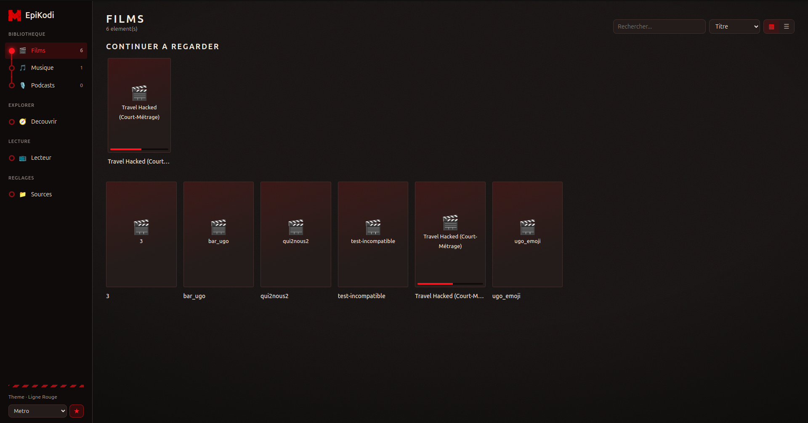

# EpiKodi

EpiKodi is a desktop media center inspired by Kodi. It lets users play and
organize videos, music, podcasts and other digital media locally or over a
network.



> Student project developed as part of the Epitech curriculum.

The project aims to deliver a functional MVP in approximately five person-days,
with a separate architecture for the Electron main process, the React renderer
and shared TypeScript contracts.

See [`EPIKODI_ISSUES.md`](../EPIKODI_ISSUES.md) for the detailed backlog.

## Stack

- **Electron** + **React** (Vite) for the user interface
- **TypeScript** throughout the main, renderer and shared layers
- **FFmpeg / ffprobe** for media processing (codec detection, transcoding and metadata)
- **SQLite** (better-sqlite3) for the library (sources, media, metadata and TMDB cache)
- **TMDB** for enriching movie details (posters, synopsis, release year and rating)

## Features

- **Video/audio player**: controls, keyboard shortcuts (Space, arrow keys, M, F),
  format detection with ffprobe and MP4 conversion through FFmpeg when Chromium
  cannot play the file directly
- **Sources**: local folders or mounted network shares (CIFS/NFS/SSHFS/GVFS,
  UNC paths on Windows), asynchronous recursive scanning with timeouts, last scan
  status, rescanning and folder navigation
- **Indexing**: after scanning, ffprobe extracts duration, codecs, resolution and
  audio tags (title, artist, album, track, genre and year); FFmpeg then generates
  a thumbnail for each video (a frame at 10% of its duration, shown when no TMDB
  poster is available). Only new or modified files are analyzed again
- **Playback resume**: video and podcast positions are saved; when playback is
  resumed, the player offers to continue or start over (not before 30 seconds or
  after 95% of the duration)
- **Library**: Movies / Music / Podcasts sections (an audio file is a podcast if
  it has the "Podcast" genre or is stored in a "podcast" folder), grid or list
  view, accent-insensitive search and sorting; "Continue Watching" rows with a
  progress bar and "Recently Added" above the grid
- **Media details**: TMDB poster and backdrop, synopsis, technical information
  and manual correction of the TMDB match
- **Discover**: movies recommended through TMDB (trending, now playing, upcoming,
  popular and top rated), whether or not they are in the library, with synopsis,
  release date, rating, genres, runtime, director and cast; an owned movie can be
  played directly from its details page
- **Themes**: System / Light / Dark / Cinema / Metro
  (`renderer/src/theme/themes.ts`, with each theme defined as a set of CSS
  variables). Metro includes an activation animation and a button to switch to
  the Dark Ones and Red Line themes, each with its own animation (optional images
  are documented in `renderer/public/metro/README.md`)

## Project structure

```
Epikodi/
├─ main/        # Electron main process (window, IPC, filesystem access)
├─ renderer/    # React application (Vite) displayed in the window
├─ shared/      # Types and contracts shared between main and renderer
└─ dist/        # Build output (main) - generated and not versioned
```

The renderer and main process communicate through typed IPC (`contextBridge` in
`main/preload.ts`), with `nodeIntegration` disabled in the renderer.

## Requirements

- Node.js >= 20
- npm >= 10
- FFmpeg (providing `ffprobe` and `ffmpeg`), available in `PATH`. It detects the
  format and codec of selected files (Issue 2.3) and provides an MP4 H.264/AAC
  transcoding fallback when direct playback is not possible (Issue 2.4). It is
  already installed in the Docker image. Locally, install it with
  `apt install ffmpeg` / `brew install ffmpeg`, or use the Windows binaries from
  ffmpeg.org. Custom paths can be set with `FFPROBE_PATH` / `FFMPEG_PATH`.
- Native build tools (`python3` and a C/C++ compiler), required by
  `better-sqlite3` when no prebuilt binary is available for the selected platform
  and Node.js version. They are already installed in the Docker image
  (`build-essential`, `python3`). Locally, use `apt install build-essential
  python3`, Xcode Command Line Tools on macOS, or "Desktop development with C++"
  on Windows.

## Installation

```bash
npm install
```

This installs the root dependencies and the `renderer` workspace dependencies,
then rebuilds `better-sqlite3` for the Electron ABI through the `postinstall`
script.

### TMDB key (optional)

Everything works without a key except movie enrichment and the Discover section.
To enable them:

1. Create an account on [themoviedb.org](https://www.themoviedb.org/) and create
  an API key in *Settings > API*.
2. Run `cp .env.example .env` and set `TMDB_API_KEY` (v3 key) **or**
  `TMDB_ACCESS_TOKEN` (v4 token). `TMDB_LANGUAGE` (default: `fr-FR`) controls
  the language of titles and synopses.
3. Restart the app and **Rescan** the sources. Movies that have not been
  searched yet will be sent to TMDB.

The title and year are inferred from the file name (`Inception.2010.1080p.mkv`
-> *Inception*, 2010). A movie is matched only when the title really corresponds,
so personal videos remain without a details page. Responses and images are cached
(SQLite database and the `tmdb/` directory in the app data), so rescanning does
not repeat the requests. If a movie is matched incorrectly, open its details and
use **Correct TMDB match**.

## Development

```bash
npm run dev
```

This starts the Vite server (renderer), the TypeScript watch compilation for
`main` and Electron in parallel. Electron waits until the other two processes are
ready.

## Building

```bash
npm run build
```

This compiles `main/` (TypeScript -> `dist/main`) and builds `renderer/` (Vite ->
`renderer/dist`).

```bash
npm start
```

This launches Electron using the compiled build (`dist/main/index.js`).

## Code quality

```bash
npm run lint          # oxlint (main, shared) + lint du renderer
npm run format        # prettier --write
npm run format:check  # prettier --check (utilise par la CI)
```

GitHub Actions CI (`.github/workflows/ci.yml`) runs `format:check`, `lint` and
`build` on every push and pull request.

## Running with Docker

Electron is a GUI application, so the container runs on a virtual display (Xvfb)
and exposes it in the browser through noVNC. No X server is required on the host
machine, and the setup works similarly on Linux, macOS and Windows.

```bash
docker compose up --build
```

Then open **http://localhost:6080** (automatically redirected to the noVNC viewer)
to see and use the EpiKodi window as if it were running locally.

- The source code is mounted as a volume: `npm run dev` runs inside the
  container (Vite + tsc watch + Electron), so hot reload works normally while
  editing files on the host.
- `node_modules` is managed in a separate Docker volume, rather than using the
  host directory, to remain consistent with the container OS and architecture.
- Run `docker compose down` to stop the app. Run `docker compose up --build` to
  rebuild it after changing `package.json` or the `Dockerfile`.

**Keep this up to date as the backlog evolves**: the `Dockerfile` already
installs FFmpeg (Issue 2.3/2.4) and the build tools for `better-sqlite3`
(Issue 3.1). If a future issue adds a system dependency, such as an `apt`
package for subtitle playback or a network driver, add it to the `Dockerfile`
and rerun `docker compose up --build`.
